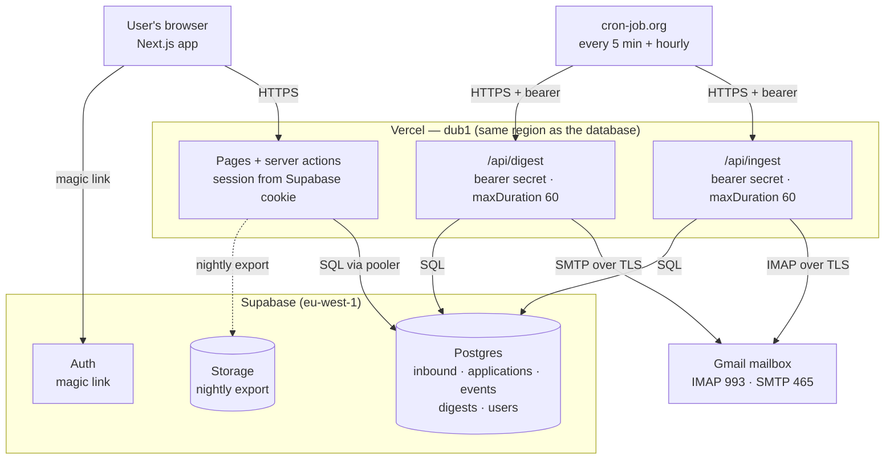

# D2 — Shape: the big parts

**Status:** 🟡 draft, awaiting review
**Date:** 2026-10-23

## A challenge to the template, first

The template says: draw the pictures, _then_ choose the style. I disagree for this project. D1.7
($0) and ADR 0002 (serverless) already decided the style — drawing containers first and "then
choosing" would be theatre, and would quietly invite a style the drivers cannot pay for.

So: **style first, then pictures, then boundaries.**

---

## 1. Style: modular monolith, deployed as serverless functions

The code is **one deployable** (a Next.js app) whose internals are split into modules that own their
own rules and tables. It runs as **stateless functions on Vercel**, with **Postgres as both the
system of record and the work queue**.

There is **no separate worker**, because no work needs to outlive a request: ingestion is triggered,
bounded, and small (measured at 1.3–1.7 s).

| Option                                                   | Strength                                                                                                      | Weakness                                                                                                       |
| -------------------------------------------------------- | ------------------------------------------------------------------------------------------------------------- | -------------------------------------------------------------------------------------------------------------- |
| **A. Modular monolith as serverless functions** (chosen) | One deploy, $0, no server to keep awake; module boundaries keep it changeable; measured to fit the time limit | Cold starts; per-function time limits; must enforce module boundaries by discipline (D8)                       |
| B. Monolith + always-on worker process                   | A real background process; no serverless limits                                                               | Costs money (Railway ~$5) — directly violates D1.7                                                             |
| C. Microservices (ingest, parser, web separately)        | Independent scaling and release                                                                               | Network failures between services, three deploys, three sets of config — for one user and eleven emails a week |
| D. Server-rendered monolith on a VPS                     | Simple mental model, no cold starts                                                                           | Requires ops and a paid host; worst fit for a solo part-time builder                                           |

**Recommendation: A.** It is the only option that satisfies D1.7 without inventing a driver nothing
else asks for. C is specifically rejected: "microservice premium" is real, and we would pay it for
traffic that does not exist.

---

## 2. System context

```
                    ┌──────────────────────────────────────────┐
                    │              CareerOS (one box)          │
   ┌────────┐       │  Organises an active job search:         │
   │  User  │──────▶│  ingest mail, parse it, show what is     │
   └────────┘ HTTPS │  due, send one weekly digest             │
        ▲           └──────────────────────────────────────────┘
        │ digest email               ▲            ▲
        │                            │ IMAP/SMTP  │ SQL over TLS
        │                            │  (TLS)     │
        │                     ┌──────┴─────┐  ┌───┴──────────┐
        └─────────────────────│   Gmail    │  │  Supabase    │
                              │  mailbox   │  │  Postgres    │
                              └────────────┘  └──────────────┘
                                     ▲
                              ┌──────┴──────┐
                              │   Scheduler │  (cron-job.org, free)
                              └─────────────┘  HTTPS + bearer token
```

Three outside systems, and that is all: **Gmail** (the only source of information), **Supabase**
(storage), **a scheduler** (the only thing that makes anything happen on a timer). The user is a
single person.

---

## 3. Containers



**Every box, its owner, and where it runs:**

| Box                          | Owner                           | Runs on                  |
| ---------------------------- | ------------------------------- | ------------------------ |
| Browser app                  | us                              | the user's device        |
| Pages + server actions       | us                              | Vercel, `dub1`           |
| `/api/ingest`, `/api/digest` | us                              | Vercel, `dub1`, max 60 s |
| Postgres                     | us (data), Supabase (hosting)   | Supabase, `eu-west-1`    |
| Auth                         | us (config), Supabase (hosting) | Supabase                 |
| Storage (exports)            | us                              | Supabase                 |
| Gmail mailbox                | us (account)                    | Google                   |
| Scheduler                    | us (job config)                 | cron-job.org             |

The single most important line above: **Vercel `dub1` and Supabase `eu-west-1` are deliberately in
the same corner of the world.** Step 9 measured 13.6 s → 1.7 s from that one decision.

---

## 4. Trust boundaries

| #      | Boundary                              | What crosses it                                             | Why it matters                                                                             |
| ------ | ------------------------------------- | ----------------------------------------------------------- | ------------------------------------------------------------------------------------------ |
| **B1** | Browser → Vercel                      | Session cookie, form input, user actions                    | Public internet. Every request must be authorised by the session, never by a parameter     |
| **B2** | Scheduler → Vercel                    | A bearer token and nothing else                             | **A public URL that reads an email mailbox.** Anyone who finds it can force ingestion runs |
| **B3** | Vercel → Gmail                        | Mailbox credentials (server-side only)                      | Full read/send power over the mailbox. Never leaves the server, never in logs              |
| **B4** | Gmail → (forwarded mail) → our ingest | **Content written by strangers**, including third-party PII | The least trusted data in the system: a forged forward can create records                  |
| **B5** | Vercel → Supabase                     | SQL over TLS, service credentials                           | Bypasses row-level security if the service key is used carelessly                          |

B2 and B4 are the two that will get real attention in D7. B2 because it is an unauthenticated door
with a secret in front of it; B4 because **anyone can send an email**, and email is our input.

---

## 5. Every arrow: direction, protocol, failure story

| Arrow              | Direction | Protocol       | If it fails                                                                                             |
| ------------------ | --------- | -------------- | ------------------------------------------------------------------------------------------------------- |
| Browser → pages    | →         | HTTPS          | Error page; local state lost; retry is safe                                                             |
| Pages → Postgres   | →         | TLS, pooler    | 500 to the user; read-only screens show cached data or an error, never stale-as-fresh                   |
| Browser → Auth     | →         | HTTPS redirect | Cannot sign in; app is unusable, which is honest                                                        |
| Scheduler → ingest | →         | HTTPS + bearer | **Nothing arrives.** Heartbeat goes stale; banner appears (D1.6). Nothing is lost — mail waits in Gmail |
| Ingest → Gmail     | →         | IMAP/TLS       | Ingest errors; queue untouched; **never recorded as "no new mail"**                                     |
| Ingest → Postgres  | →         | TLS            | 500; next run retries; unique key prevents duplicates                                                   |
| Digest → Gmail     | →         | SMTP/TLS       | Send fails; must be retried inside the catch-up window without double-sending (D4/D5)                   |
| Digest → Postgres  | →         | TLS            | No digest; same idempotency key protects the retry                                                      |
| Export → Storage   | →         | HTTPS          | Backup fails; a missed backup is logged and surfaced                                                    |

**Rule that follows from B4:** an email is _untrusted input_, not a fact. It is stored raw, parsed
defensively, and anything below confidence goes to Review. The system never treats "an email said so"
as authoritative.

---

## 6. What this shape deliberately does not have

No message broker, no worker fleet, no CDN logic, no read replicas, no search engine, no cache tier,
no service mesh. Each one is a component that would need a driver to justify it, and none of the seven
drivers asks for it.

The only "infrastructure" beside the app and the database is **a free cron service** — which is the
weakest link in the whole design, and therefore the one with an explicit staleness signal.
