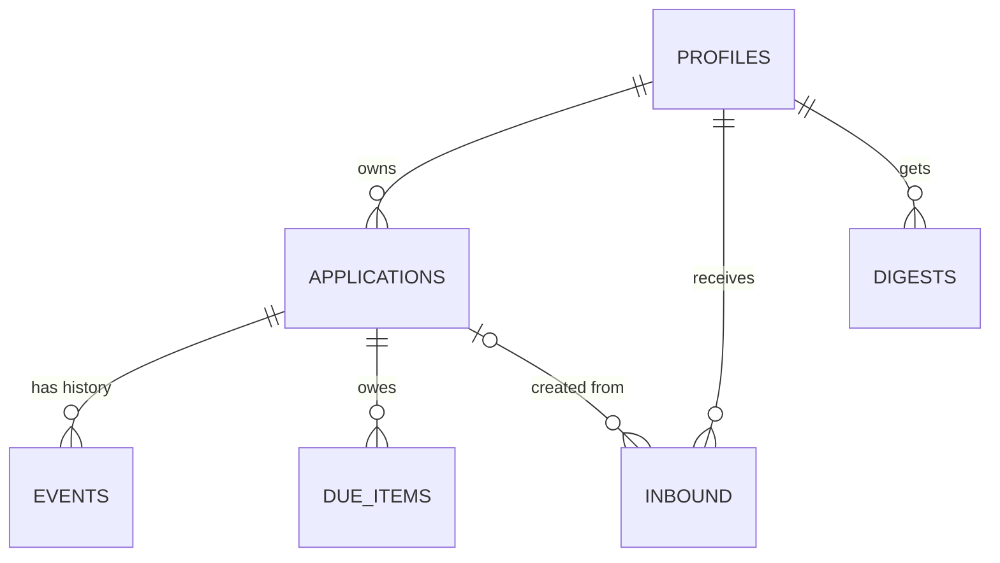

# D4.1 — Entities and relationships

**Status:** 🟡 draft, awaiting review
**Date:** 2026-10-24
**Scope:** the tables, their owners, their columns, and how they connect. State machines, invariants,
concurrency and retention come in D4.2–D4.7.

## 1. The seven tables

| Table          | Owner module | Holds                                                                          | Why it exists                                                      |
| -------------- | ------------ | ------------------------------------------------------------------------------ | ------------------------------------------------------------------ |
| `profiles`     | (platform)   | One row per user: timezone                                                     | `auth.users` is Supabase's; we need a timezone and a place to grow |
| `applications` | ledger       | The applications themselves                                                    | The thing the product is about                                     |
| `events`       | ledger       | Append-only history of every change                                            | Timeline now, analytics later (ADR 0007)                           |
| `inbound`      | intake       | One row per forwarded email: raw text, parse result, queue state, review state | The queue **and** the audit trail of what arrived                  |
| `due_items`    | planning     | Things owed, both extracted and generated                                      | Snooze/done state has to live somewhere                            |
| `digests`      | delivery     | One row per sent weekly email                                                  | The idempotency key that prevents double sends                     |
| _(none)_       | —            | —                                                                              | No `review_items` — see decision 1 below                           |

## 2. Relationships



- One user owns many applications, inbound emails, and digests.
- One application has many events and many due items.
- An inbound email may be linked to the application it created or updated (`application_id`,
  nullable), which is what makes "where did this application come from?" answerable.
- Deleting a user cascades to everything they own. There is no orphan data by design.

## 3. SQL

```sql
-- One row per user. Mirrors auth.users; the timezone drives the digest.
create table public.profiles (
  id          uuid primary key references auth.users(id) on delete cascade,
  timezone    text not null default 'Africa/Nairobi',
  created_at  timestamptz not null default now()
);

-- The record. `dedupe_key` is a normalised company|role string used by intake
-- to find an existing application instead of creating a second one.
create table public.applications (
  id               uuid primary key default gen_random_uuid(),
  owner_id         uuid not null references public.profiles(id) on delete cascade,
  company          text not null,
  role             text,
  stage            text not null default 'applied'
                     check (stage in ('applied','interviewing','offer','rejected','withdrawn')),
  source           text not null default 'manual'
                     check (source in ('manual','email')),
  dedupe_key       text not null,
  applied_at       timestamptz,                 -- optional: dates cannot be assumed
  last_activity_at timestamptz not null default now(),
  created_at       timestamptz not null default now(),
  updated_at       timestamptz not null default now()
);
create index applications_owner_idx  on public.applications (owner_id, last_activity_at desc);
create index applications_dedupe_idx on public.applications (owner_id, dedupe_key);

-- Append-only. Never updated, never deleted except by cascade.
create table public.events (
  id             bigserial primary key,
  owner_id       uuid not null references public.profiles(id) on delete cascade,
  application_id uuid not null references public.applications(id) on delete cascade,
  type           text not null,                 -- created | stage_changed | ...
  payload        jsonb not null default '{}'::jsonb,
  occurred_at    timestamptz not null default now()
);
create index events_app_idx on public.events (application_id, occurred_at);

-- One row per forwarded email: the queue, the review queue, and the audit trail.
create table public.inbound (
  id              uuid primary key default gen_random_uuid(),
  owner_id        uuid not null references public.profiles(id) on delete cascade,
  message_id      text not null unique,          -- the email's own Message-ID
  from_address    text,
  subject         text,
  received_at     timestamptz not null,
  raw_body        text,                          -- deleted 7 days after receipt
  snippet         text,                          -- deleted 30 days after receipt
  status          text not null default 'pending'
                    check (status in ('pending','processing','done','needs_review','dead','ignored')),
  attempts        int not null default 0,
  next_attempt_at timestamptz not null default now(),
  lease_until     timestamptz,
  last_error      text,
  parsed          jsonb,                         -- proposed company/role/stage/confidence
  application_id  uuid references public.applications(id) on delete set null,
  created_at      timestamptz not null default now(),
  updated_at      timestamptz not null default now()
);
create index inbound_ready_idx on public.inbound (status, next_attempt_at);

-- What is owed. `key` makes generated items idempotent (D4.2 defines the format).
create table public.due_items (
  id             uuid primary key default gen_random_uuid(),
  owner_id       uuid not null references public.profiles(id) on delete cascade,
  application_id uuid not null references public.applications(id) on delete cascade,
  kind           text not null check (kind in ('extracted','silence')),
  title          text not null,
  due_at         timestamptz not null,
  state          text not null default 'open'
                   check (state in ('open','done','snoozed','dismissed')),
  snoozed_until  timestamptz,
  key            text not null,
  created_at     timestamptz not null default now(),
  updated_at     timestamptz not null default now(),
  unique (owner_id, key)
);
create index due_open_idx on public.due_items (owner_id, state, due_at);

-- One row per week per user: the anti-duplicate key from ADR 0006.
create table public.digests (
  id         uuid primary key default gen_random_uuid(),
  owner_id   uuid not null references public.profiles(id) on delete cascade,
  iso_year   int not null,
  iso_week   int not null,
  status     text not null default 'sent' check (status in ('sent','failed')),
  sent_at    timestamptz,
  unique (owner_id, iso_year, iso_week)
);
```

Row-level security is added in D4.3, but the shape is already decided: every table has `owner_id`,
and every policy is `owner_id = auth.uid()`.

---

## 4. Three decisions taken here

### Decision 1 — Is "Review" its own table?

| Option                                | Strength                                                                                          | Weakness                                                                                                          |
| ------------------------------------- | ------------------------------------------------------------------------------------------------- | ----------------------------------------------------------------------------------------------------------------- |
| **A. A status on `inbound`** (chosen) | One table, no join, no second lifecycle to keep in sync. Review _is_ an email awaiting a decision | A review item inherits the email's 7-day purge; once the raw body is gone, the review shows only the snippet      |
| B. A separate `review_items` table    | Survives the purge; can hold richer fields                                                        | A second lifecycle to keep consistent with `inbound`; a join on every Review screen; two tables that can disagree |

**Recommendation: A.** Same data, one lifecycle. The purge concern is real but small — a review item
unresolved after 7 days is a signal that the queue is failing, and D1.6's freshness signal covers it.

### Decision 2 — How is a duplicate application prevented?

| Option                                      | Strength                                                                   | Weakness                                                                                                                                   |
| ------------------------------------------- | -------------------------------------------------------------------------- | ------------------------------------------------------------------------------------------------------------------------------------------ |
| **A. `dedupe_key` column + code** (chosen)  | Allows the "warn but allow anyway" behaviour from S6; one index for lookup | Not a hard guarantee — two emails parsed differently could create two rows                                                                 |
| B. Unique index on `(owner_id, dedupe_key)` | Database-enforced                                                          | Makes "allow anyway" impossible without a nonsense suffix; a legitimate second application to the same company becomes a migration problem |

**Recommendation: A**, with the weakness stated plainly: the guarantee is **code plus tests**, not the
database. The _hard_ guarantee stays where it belongs — `inbound.message_id` is unique, so one email
can never create two applications.

### Decision 3 — Identifier types

**UUIDs** for anything a user or URL can see (`applications`, `inbound`, `due_items`, `digests`) —
unguessable, safe in links. **`bigserial`** for `events`, which is internal, high volume and always
read in order.

---

## 5. What D4.1 leaves open (deliberately)

| Question                                                      | Answered in |
| ------------------------------------------------------------- | ----------- |
| What states may each thing be in, and what moves are allowed? | D4.2        |
| What must never be true, and where is it enforced?            | D4.3        |
| Which facts are derived, and how are they rebuilt?            | D4.4        |
| What if two events race?                                      | D4.5        |
| What must change in one transaction?                          | D4.6        |
| How long is each field kept, and how is it deleted?           | D4.7        |
