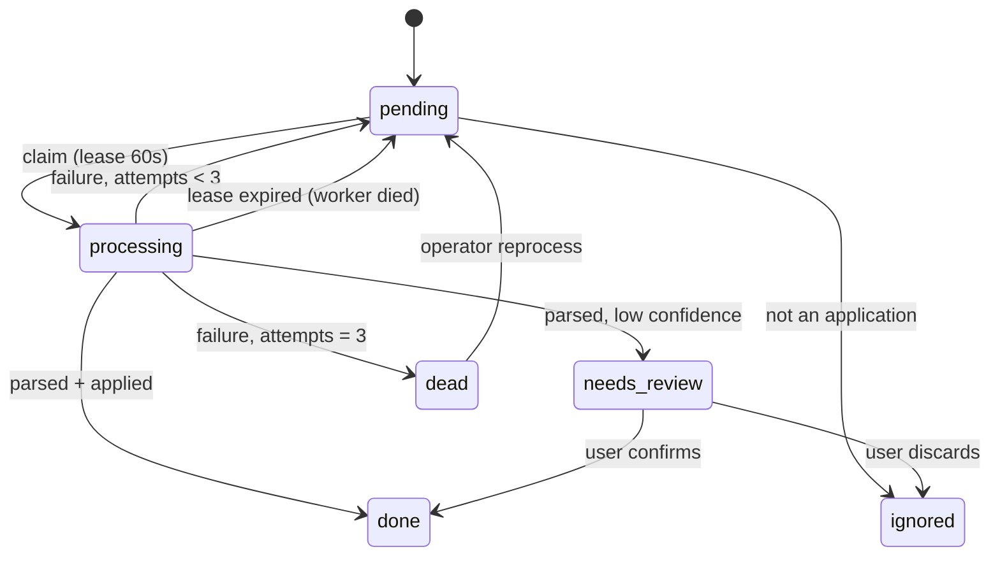
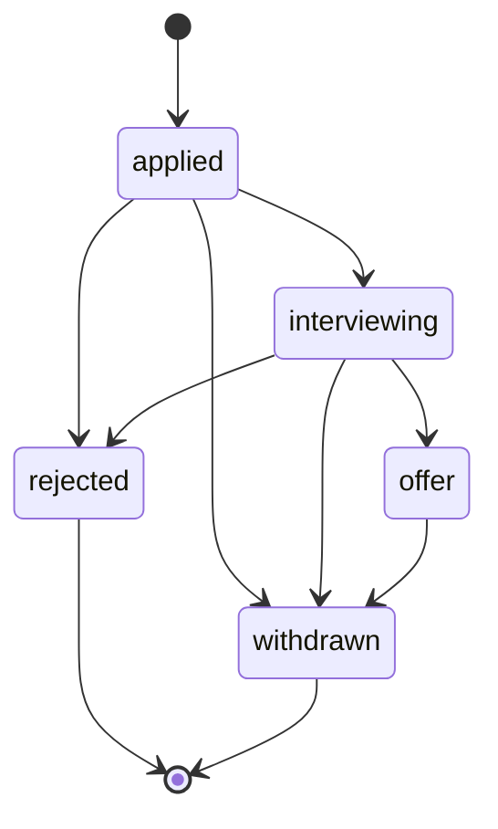
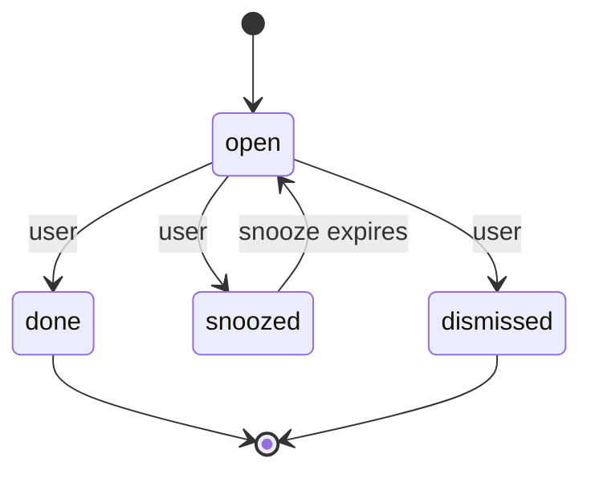

# D4.2 — State machines

**Status:** 🟡 draft, awaiting review
**Date:** 2026-10-24
**Scope:** the states each thing can be in, the moves allowed between them, who triggers each move,
and which moves are safe to repeat.

## Why this is design, not details

Four things in this system change over time: an email being processed, an application progressing,
a due item being handled, and a digest being sent. Each is a lifecycle. Writing the table down is
what stops a later feature from inventing a transition that corrupts the data — for example, pushing
a rejected application back to "interviewing" because an old email arrived late.

---

## 1. `inbound.status` — the job and review lifecycle

| From           | Event                  | To             | Triggered by   | Safe to repeat?                                         |
| -------------- | ---------------------- | -------------- | -------------- | ------------------------------------------------------- |
| `pending`      | claim                  | `processing`   | ingest run     | Yes — `SKIP LOCKED` means one claim per run             |
| `processing`   | parsed with confidence | `done`         | ingest         | Yes — unique `message_id` prevents a second application |
| `processing`   | parsed, low confidence | `needs_review` | ingest         | Yes — one row, status only                              |
| `processing`   | failure, attempts < 3  | `pending`      | ingest         | Yes — attempts increments, backoff applies              |
| `processing`   | failure, attempts = 3  | `dead`         | ingest         | Yes — stays dead                                        |
| `processing`   | lease expired          | `processing`   | another worker | Yes — attempts increments                               |
| `pending`      | not an application     | `ignored`      | ingest         | Yes                                                     |
| `needs_review` | user confirms          | `done`         | user           | Yes — second confirm is a no-op                         |
| `needs_review` | user discards          | `ignored`      | user           | Yes                                                     |
| `dead`         | operator reprocess     | `pending`      | operator       | Yes — attempts reset                                    |

**Forbidden:** `done` → anything. A processed email is history. A late-arriving message is a _new_
row, which is exactly why `message_id` is unique.

---

## 2. `applications.stage` — the application lifecycle

| From                       | Event               | To             | Triggered by   | Safe to repeat?                                                    |
| -------------------------- | ------------------- | -------------- | -------------- | ------------------------------------------------------------------ |
| —                          | application created | `applied`      | intake or user | Yes — duplicate creates are blocked by `message_id` / dedupe check |
| `applied`                  | interview invite    | `interviewing` | intake         | Yes — same target stage writes no second event                     |
| `applied` / `interviewing` | rejection email     | `rejected`     | intake         | Yes                                                                |
| `interviewing`             | offer email         | `offer`        | intake         | Yes                                                                |
| any open                   | user withdraws      | `withdrawn`    | user           | Yes                                                                |
| `offer`                    | user declines       | `withdrawn`    | user           | Yes                                                                |

**Forbidden:** any move backwards. `rejected` and `withdrawn` are terminal.

**The one exception — corrections.** A mis-parsed stage is possible, and forbidding correction would
leave the user stuck. So there is a separate, explicit move:

> **Correction:** the user may set any stage on any application, and it writes an event of type
> `stage_corrected` with `from` and `to`. It is never triggered by an email.

This is a deliberate hole in the state machine: an email can never move an application backwards, but
a human can. The event log records that a human did it, which is what makes the hole safe.

---

## 3. `due_items.state` — the item lifecycle

| From      | Event                  | To          | Triggered by      | Safe to repeat?                        |
| --------- | ---------------------- | ----------- | ----------------- | -------------------------------------- |
| —         | item generated         | `open`      | planning `sync()` | Yes — unique `(owner_id, key)`         |
| `open`    | user completes         | `done`      | user              | Yes — second complete is a no-op       |
| `open`    | user snoozes           | `snoozed`   | user              | Yes                                    |
| `snoozed` | `snoozed_until` passes | `open`      | planning `sync()` | Yes — state only moves forward in time |
| `open`    | user dismisses         | `dismissed` | user              | Yes                                    |

**Forbidden:** `done` and `dismissed` are terminal. A regenerated item gets a **new key**, so it can
never resurrect a finished one. That is the rule that keeps the silence prompts from nagging: once
you dismiss "follow up with X", the same prompt cannot return for that application.

---

## 4. `digests` — the send lifecycle

The current table has only `sent` / `failed`. That is not enough: with two states there is a window
between "we decided to send" and "we sent" where a crash is unrecoverable in both directions.

**Amended statuses:** `pending` → `sending` → `sent` | `failed`.

| From      | Event                              | To        | Triggered by         | Safe to repeat?                            |
| --------- | ---------------------------------- | --------- | -------------------- | ------------------------------------------ |
| —         | weekly row claimed                 | `pending` | digest run           | Yes — unique `(owner, iso_year, iso_week)` |
| `pending` | send begins                        | `sending` | digest run           | Yes                                        |
| `sending` | SMTP accepted                      | `sent`    | digest run           | Yes — stamp `sent_at` once                 |
| `sending` | SMTP rejected                      | `failed`  | digest run           | Yes                                        |
| `sending` | older than 10 min, unknown outcome | `failed`  | recovery in `sync()` | Yes once — bounded by the catch-up window  |
| `failed`  | retry within the 6-hour window     | `pending` | digest run           | Yes — at most one retry                    |

**The trade this encodes:** a crash mid-send can produce **at most one duplicate** email, never a
missing one, and never a loop. Given "exactly one digest per week" is a target (D1.2), the honest
statement is: _exactly one in normal operation, at most two after a crash_ — and the second only
inside the catch-up window.

---

## 5. What these tables forbid, in one list

| Forbidden                                     | Why it matters                                               |
| --------------------------------------------- | ------------------------------------------------------------ |
| A processed email returning to `pending`      | Re-processing is how duplicates are born                     |
| A terminal application stage moving           | Late or out-of-order emails would rewrite history            |
| An email moving a stage backwards             | A stale rejection from another role could "un-interview" you |
| A finished due item reappearing               | The silence prompt becomes nagging                           |
| A week's digest row being created twice       | The unique key is the entire anti-duplicate design           |
| Any transition without an event (ledger only) | The timeline and any future analytics would silently drift   |

---

## 6. Open for later sub-steps

| Question                                                      | Step |
| ------------------------------------------------------------- | ---- |
| Which of these are database constraints vs code?              | D4.3 |
| What happens when two transitions race?                       | D4.5 |
| What must be written in the same transaction as a transition? | D4.6 |
